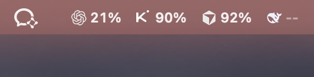
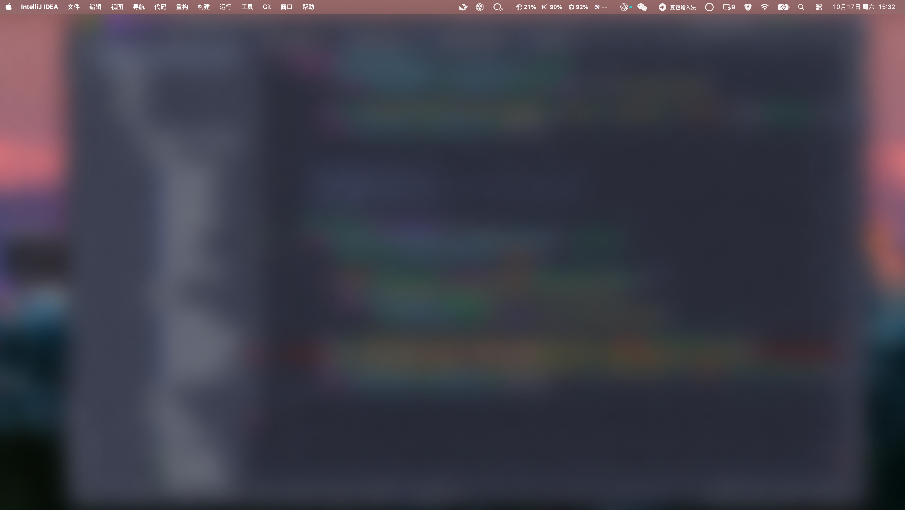

<div align="center">

# QuotaBar

### AI 額度，抬頭就看見。

Codex / GPT · Kimi · Cursor · DeepSeek<br>
把各平台的剩餘額度與餘額，集中在 Mac 頂端選單列。

[简体中文](README.md) · **繁體中文** · [English](README.en.md) · [日本語](README.ja.md) · [한국어](README.ko.md) · [Español](README.es.md) · [Français](README.fr.md) · [Deutsch](README.de.md) · [Português (Brasil)](README.pt-BR.md)



**少開幾個用量頁面，多留一點專注。**

</div>

寫程式、切換模型、執行任務時，你想知道的往往只是：還剩多少額度，現在適合用哪個工具。QuotaBar 用服務圖示和簡潔數字，讓你一眼掌握各項讀數，繼續手上的工作。



<sub>真實使用截圖。頂端選單列維持原圖；其餘畫面已柔和霧化去識別化，沒有馬賽克。數值僅代表截圖當下，`--` 表示沒有可用讀數。</sub>

## 讓額度回到視線裡

- **多服務同時顯示**：按需顯示或隱藏 Codex / GPT、Kimi、Cursor、DeepSeek。
- **讀數有依據**：Codex 顯示可用額度視窗中的最低剩餘比例；Cursor 可選 Cursor Models 或 Other Models；DeepSeek 顯示實際餘額。
- **原生玻璃介面**：以 AppKit、SwiftUI 和 macOS 27 原生材質打造面板與設定。
- **本機用量歷史**：SQLite 小時取樣，提供日、週、月、季、年的彙總、環圖與熱力圖。
- **可延伸的原生工具**：Swift Package Manager 建置，無第三方執行階段依賴。

## 接入狀態與讀數範圍

Codex / GPT 讀取本機 Codex 帳號用量，不是一般 ChatGPT 訊息額度。Kimi 會員用量介面尚無公開文件，可能變動。Cursor 使用本機登入狀態。DeepSeek 透過官方 API Key 查詢餘額。ZCode 尚未實作；Claude Code 保留既有帳號面板，未加入新的多服務頂端列。

歷史圖表記錄取樣間的額度百分點變化，不代表 Token 數、帳單金額或工時；DeepSeek 餘額暫不納入彙總消耗圖。

## 開始使用

需要 **macOS 27+、Xcode 27.x / Swift 6.4**。目前發布原始碼，尚無本定製版的 GitHub 安裝包。執行後，從選單列開啟設定，選擇服務並配置自己的帳號。

```bash
git clone https://github.com/MyKWK/QuotaBar.git
cd QuotaBar
swift build
swift run QuotaBar
```

## 隱私與憑證

不附帶可用帳號或密鑰。Kimi 權杖及直接儲存的 DeepSeek Key 位於本機 `~/Library/Application Support/QuotaBar/credentials.json`，檔案權限 `0600`、目錄權限 `0700`；這是受權限保護的明文檔案。既有多帳號憑證使用 macOS Keychain。查詢會將必要憑證傳送至相應服務。

[完整開發說明](CONTRIBUTING.md) · [安全說明](SECURITY.md) · [來源沿革](docs/ORIGINS.md) · [完整授權](LICENSE)

## 原創工作與程式碼來源

專案最早是 MyKWK 的本機 Kimi 額度工具，2026 年 8 月已投入使用。9 月 16 日的多服務開發引入了 Chiloh / chilohwei 維護的另一個同名 QuotaBar 專案，再結合我們的 Kimi 功能、產品設計與後續擴充。這個版本由 MyKWK 維護。

[Chiloh / chilohwei — QuotaBar](https://github.com/chilohwei/QuotaBar)

實際沿用的外部程式碼保留原作者署名與完整自訂授權。個人、教育、研究及其他非商業用途依原授權使用；商業用途須先取得原作者書面授權。本專案未獲上游或各服務商官方背書。

---

如果它讓你少開幾個額度頁面，歡迎給專案一個 Star，也歡迎回報問題與分享使用體驗。
